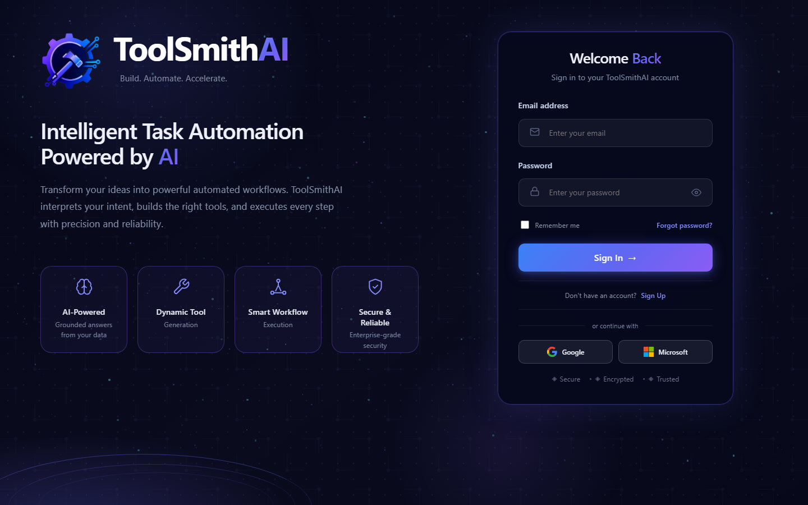

# ToolSmithAI

**Built by Harpreet Kaur.**

ToolSmithAI helps non-technical users ask questions about a Microsoft SQL Server database or an uploaded CSV/Excel file in everyday language. It returns tables, KPIs, charts and grounded insights, while checking every generated query before it reaches the database.

> **Project status:** working, tested and ready for a controlled pilot. It still needs the production infrastructure listed under [Limitations](#limitations) before being used for critical workloads.

**Read next:** [Architecture](ARCHITECTURE.md) · [Security](SECURITY.md) · [Testing](TESTING.md)

## Product preview



## The problem

Important business information is often difficult to reach without SQL knowledge or help from an analyst. A basic text-to-SQL tool can shorten that process, but it can also choose the wrong table, invent a join or produce an unsafe statement. I built ToolSmithAI around one rule: **the model proposes, deterministic code decides.**

## Who it is for

- Business and operations leaders who need answers but do not write SQL.
- Analysts who want a reviewable starting point for recurring questions.
- Data teams that want natural-language access with independent safety checks.
- Organizations that work with both SQL Server databases and ordinary spreadsheets.

## What it does

- **Connects** to Microsoft SQL Server, then discovers and profiles its metadata automatically (tables, columns, relationships, views).
- **Answers questions** through one AI-first route: embedding-based retrieval selects the relevant schema, the model proposes a plan, and the plan is validated before anything runs.
- **Validates every statement** with a T-SQL syntax-tree check against the retrieved schema: read-only only, known tables, columns and joins, and no credential-like columns.
- **Executes read-only SQL against current data**, with a row cap and query timeout.
- **Asks instead of guessing** when a question is ambiguous, and keeps follow-up context between questions.
- **Presents results** as tables, KPIs, grounded insights and charts.
- **Remembers validated plans** (in memory and in a durable SQLite store). A cache hit skips the model calls but is still re-validated and re-executed, so numbers stay current. Result rows and credentials are never cached.
- **Works with uploaded CSV and Excel files** through the same workspace.
- **Exports** results and reports to CSV, Excel and PDF, with optional email delivery.
- **Runs recurring work** through saved workflows, schedules, history and notifications.

## How it works, in one picture

```text
Question -> relevant schema (vector retrieval) -> AI proposes a plan
         -> deterministic validation -> read-only SQL on current data
         -> table / KPIs / chart / insight
```

The full flow, including caching, clarification and uploaded datasets, is in [ARCHITECTURE.md](ARCHITECTURE.md).

## Engineering evidence

| Check | Result |
| --- | --- |
| Backend test suite | 6,369 passed, 9 skipped, 0 failed (9 skips: 8 retired-planner tests kept as history, 1 needs Windows symlink permission) |
| Frontend test suite | 175 passed, 0 failed |
| Frontend lint and production build | Both passed |
| Python dependency audit | No known vulnerabilities |
| npm dependency audit | 0 vulnerabilities |
| API surface | 76 routes, each used by the frontend or needed for health monitoring |

These results show how the software was verified. Accuracy and response time will vary with the connected data, metadata, model and network, so I have not attached unsupported performance claims to this release.

## Quick start (no database needed)

Requirements: Python 3.12, Node.js 20+. Microsoft ODBC Driver 17 or 18 only if you connect SQL Server; an OpenAI API key only for AI features.

```powershell
# Backend
python -m venv .venv
.\.venv\Scripts\Activate.ps1
python -m pip install -r requirements.txt
Copy-Item .env.example .env
```

Edit `.env` and replace every `your-...` placeholder. At minimum set `JWT_SECRET`, `ENCRYPTION_KEY`, `USER_ID_SALT`, `ADMIN_API_KEY` and `USER_API_KEY` (generation commands are in `.env.example`). Never commit `.env`. The backend refuses to start with a missing or weak JWT secret.

```powershell
python -m uvicorn api.app:app --reload --host 127.0.0.1 --port 8000
```

```powershell
# Frontend, in a second terminal
Set-Location frontend
npm ci
npm run dev
```

Open <http://localhost:5173>, register a local test user, open **Data Sources**, upload a non-sensitive CSV or Excel file, select it in the **AI Workspace**, and generate a report or ask a question. Exports and History are available from the same screens. Without an OpenAI key, the uploaded-file workflow and exports still work; AI-written answers do not.

### Optional: database question answering

SQL question answering is off by default. Connect a SQL Server source you are authorized to use (a read-only login is strongly recommended), wait for automatic preparation to finish, then enable that source's ID in `.env`:

```dotenv
OPENAI_API_KEY=your-key
AI_FIRST_SQL_FAST_PATH_ENABLED=true
AI_FIRST_SQL_FAST_PATH_SOURCE_IDS=123
```

Restart the backend. Sources not on the allow-list return a clear "not enabled" answer. Optional plan caches and model overrides are documented in `.env.example`.

## Repository layout

```text
api/                 FastAPI routes and response adapters
auth/                Authentication helpers
core/sqlservice/     Retrieval, generation, validation, caching, execution
core/answering/      Answer, insight, chart and export formatting
data/                Metadata persistence and datasource services
frontend/            React + Vite web application
migrations/          Additive SQLite metadata migrations
tests/               Backend regression tests
```

## Limitations

- Live database question answering supports Microsoft SQL Server only.
- It needs an OpenAI API key and an explicit source allow-list.
- Fresh questions depend on model latency; cache hits are faster.
- Answer accuracy, latency and business impact have not been measured for this release.
- The Docker image packages the backend only; local setup above is the verified path.
- Some source files are very large (for example `App.jsx` and `routes.py`) and would benefit from refactoring.

## What I would add for production use

For critical or regulated workloads, I would add managed secrets and key rotation, SSO, a tenant-isolation review, managed metadata storage and backups, central monitoring, load and model-quality evaluation, deployment automation, and data-governance approval for every connected source.

## AI-assisted development disclosure

AI-assisted development tools were used during implementation and verification. Harpreet Kaur owned the product requirements, architectural decisions, testing, validation and final delivery.

## Author

ToolSmithAI was **built by Harpreet Kaur**.
